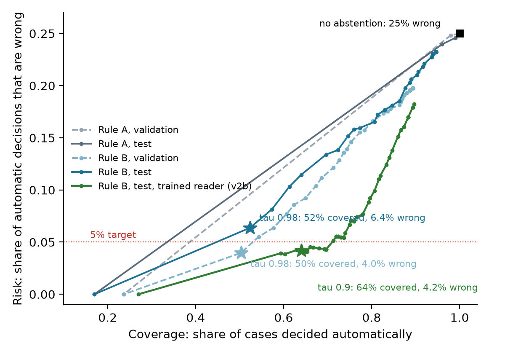

# Results (material for the paper)

Every number here comes from `docs/experiment_log.md`; the log names the run, code and data behind it. All data is synthetic (Dataset-P&ID, Paliwal et al., 2021) and every discrepancy is seeded synthetically into the specification. No result here concerns real plant drawings.

## 1. Setup in brief

- **Data:** 500 synthetic P&ID sheets, 32 symbol classes, split by sheet into 350 train, 75 validation and 75 test, with no duplicate sheets across 124,750 pairs.
- **Benchmark:** for every sheet, one clean BOM and three seeded BOMs with 1, 3 and 5 discrepancies (MISSING, EXTRA, TAG, TYPE, QUANTITY), seeded in the BOM only. That gives 2,000 cases; the test part has 300 cases on 75 sheets (75 matching, 225 with discrepancies).
- **Pipeline:**
  - YOLO11n detector on 1024 px tiles (Kaggle T4, 10 h, 87 epochs).
  - EasyOCR on text found near each symbol.
  - A deterministic verifier.
  - A decision rule that returns PASS, REVIEW or FAIL.
- **Protocol:** design choices and the threshold tau were fixed on validation data. The configuration was committed (`16db1d2`, 2026-10-18 21:48) before the single test run. Intervals are 95% bootstrap intervals over test sheets.

## 2. Component results

**Symbol detection, sheet level, IoU >= 0.5, score >= 0.25**

| Split | Symbols | TP | FP | FN | Precision | Recall |
|---|---|---|---|---|---|---|
| Validation | 8,913 | 8,912 | 3 | 1 | 0.9997 | 0.9999 |
| Test | 9,105 | 9,105 | 1 | 0 | 0.9999 | 1.0000 |

**Tag reading**

| Setting | Data | Tag exact |
|---|---|---|
| EasyOCR on ground-truth word boxes, default characters | 70 validation sheets | 80.8% |
| RapidOCR (PaddleOCR models) on ground-truth word boxes | 70 validation sheets | 82.4% |
| EasyOCR on ground-truth word boxes, character allowlist | 5 tuning sheets | 89.0% |
| End-to-end: detector boxes, text found and assigned automatically | 75 validation sheets | 62.1% |
| End-to-end | **75 test sheets** | **61.6%** |

EasyOCR was chosen over RapidOCR: it is 8 times faster on CPU (63 vs 500 ms per word) and has a lower character error rate (4.5% vs 7.4%). Finding and assigning text costs about 25 points of tag accuracy relative to reading perfect word boxes.

## 3. Verification without abstention (H1)

The deterministic verifier was run on extracted components and treated every extraction as fact.

| Split | Matching pairs declared FAIL | Wrong decisions | False findings | True findings |
|---|---|---|---|---|
| Validation | 75 / 75 (100%) | 25.0% | about 20,600 | 458 |
| Test | **75 / 75 (100%)** | 25.0% | 20,978 | 456 |

On test, false findings by type are MISSING 5,714, EXTRA 5,764, TAG 2,489, TYPE 20 and QUANTITY 6,991.

**H1 is supported:** extraction errors make the verifier declare every matching pair non-conforming.

## 4. Confidence-aware decisions (H2)

A component is trusted when its detector score is >= 0.5 and, for text-bearing classes, its reading passes the rule's test. A finding is supported only if no untrusted component could explain it. The verdict is FAIL if any finding is supported, REVIEW if findings exist but none is supported, and PASS if there are no findings.

- **Rule A (planned):** trust a reading if its OCR confidence is >= tau.
- **Rule B (revised on validation after rule A failed):** additionally require the reading's format, with letters mapped to A and digits to 9, to match a format seen for that class in training. Specific letters are not used, so the format cannot reveal the class.



*Figure: risk against coverage as tau varies from 0 to 1 in steps of 0.02. Lines join consecutive tau values. Stars mark the frozen tau = 0.98.*

| Rule, split | Coverage | Risk | PASS->PASS | PASS->REVIEW | PASS->FAIL | FAIL->FAIL | FAIL->REVIEW |
|---|---|---|---|---|---|---|---|
| No abstention, test | 100% | 25.0% | 0 | 0 | 75 | 225 | 0 |
| Rule A, tau 0.98, test | 96.0% | 24.0% | 0 | 6 | 69 | 219 | 6 |
| Rule B, tau 0.98, validation | 50.3% [45.0, 56.0] | 4.0% [1.4, 6.9] | 0 | 69 | 6 | 145 | 80 |
| **Rule B, tau 0.98, test** | **52.3% [46.3, 58.3]** | **6.4% [3.1, 9.6]** | **0** | 65 | 10 | 147 | 78 |

At the frozen tau, supported findings on test have precision 0.728 and recall 0.301.

What the table shows:
- Rule A barely improves on no abstention. Every sheet contains confidently misread tags: on validation, 585 wrong readings had confidence 0.9 to 1.0, next to 3,579 correct ones. Typical cases are truncation (`KL-80-`, 0.987) and I read as 1 (`1J-74522`, 0.923).
- Rule B lowers risk from 25.0% to 6.4% while deciding about half the cases automatically. Coverage generalises (50.3% on validation, 52.3% on test).
- **The 5% risk target set on validation is not met on test** (6.4%, interval 3.1 to 9.6).
- **No matching pair is passed automatically** under any rule or tau. Every automatic decision is a FAIL.

**H2:** supported for rule B (confidence combined with format plausibility), not for confidence alone.

### 4.1 Threshold-free comparison and ablation (computed after the test run; no setting changed)

Each case is scored by the highest tau at which a rule still decides it, which ranks cases exactly. AURC is the mean risk over all coverage levels; lower is better. Format-only is rule B with no confidence threshold. Intervals come from 2,000 sheet-level bootstrap resamples.

| Rule | Val coverage / risk at tau 0.98 | Val AURC | Test coverage / risk at tau 0.98 | Test AURC |
|---|---|---|---|---|
| A: confidence only | 98.0% / 24.8% | 0.139 | 96.0% / 24.0% | 0.154 |
| Format only | 89.3% / 19.8% | n/a | 94.7% / 23.2% | n/a |
| **B: confidence + format** | 50.3% / 4.0% | **0.077** | 52.3% / 6.4% | **0.090** |

- Paired difference, A minus B, on test: AURC 0.064 [0.051, 0.080]; risk at tau 0.98, 17.6 points [14.5, 20.9]. Validation: 0.062 [0.050, 0.074] and 20.9 points [17.9, 23.5].
- Neither signal alone makes automatic decisions trustworthy. Only the combination does.
- **Review workload.** In rule B's REVIEW cases a median 56.7% of components are untrusted on test (57.3% on validation), with a median 66 flagged findings. The rule routes cases correctly but leaves most of each REVIEW drawing for a human to check.

### 4.2 Trained reader (v2b): second, disclosed test run

EasyOCR still finds the text; a CRNN trained on ground-truth word crops plus crops cut by the pipeline itself reads it (details in `experiment_log.md`, reader_v2b). Protocol, amendment and frozen configuration were committed before the test sheets were processed again. tau = 0.90 was chosen on validation by the unchanged rule.

| Test, 75 sheets | v1 (EasyOCR, tau 0.98) | **v2b (trained reader, tau 0.90)** |
|---|---|---|
| End-to-end tag exact | 61.6% | **87.7%** |
| Rule B coverage [95% CI] | 52.3% [46.3, 58.3] | **64.0% [59.3, 68.7]** |
| Rule B risk [95% CI] | 6.4% [3.1, 9.6] | **4.2% [1.6, 6.8]** |
| AURC, rule B / rule A | 0.090 / 0.154 | **0.055** / 0.106 |
| Supported findings: precision / recall | 0.728 / 0.301 | 0.829 / 0.504 |
| REVIEW cases: median untrusted share / findings to check | 56.7% / 66 | 36.8% / 22 |
| Matching pairs passed automatically | 0 of 75 | 0 of 75 |

- Paired over test sheets, v2b minus v1: coverage +11.7 points [5.3, 17.7]; AURC -0.035 [-0.047, -0.023]; risk -2.2 points [-5.3, +0.7], not significant.
- Within v2b, rule A minus rule B: AURC 0.050 [0.039, 0.062]. The format check is still needed.
- A reader trained only on ground-truth word boxes (v2) read 99.8% of them but 77.9% of pipeline-cut crops, and made rule B worse on validation (tau 0.98: 68.7% coverage, 13.6% risk). It is reported as a negative result.
- Wrong tags with v2b: misread 47.6%, no text found 43.2%, association 9.2%.

The figure includes the v2b test curve (green).

## 5. What is not shown

- H3 (calibration) was not tested before the test run; any later analysis is post hoc.
- Graph reasoning and VLM assistance were not evaluated.
- Performance on real drawings was not measured. 12 real OPEN100 plans are available, with coarse labels and no text.
- The test sheets are used up; further tuning needs a new held-out set.

## 6. Cost

All on a CPU-only laptop (Intel i5-10300H, 8 GB RAM):
- detection about 20 s per sheet;
- extraction about 27 s per sheet;
- verification and decision under 1 s per case.

Detector training took 10.0 GPU-hours on a Kaggle T4.

## 7. Reproduce

```
python src/detect_sheets.py data/runs/Kaggle1/runs/detector/weights/best.pt data/runs/Kaggle1 test --allow-test
python src/pipeline.py data/runs/Kaggle1/predictions_test data/runs/pipeline_v1 test --allow-test
python src/decide.py data/runs/pipeline_v1/extracted_test data/runs/decide_v1 test --frozen-tau=0.98
python src/bootstrap_ci.py test 0.98
python src/make_figures.py
```
